<!-- GETTING STARTED HEADER -->

  
Five simple steps to connect any two parties in a regulatory exchange — industry to regulator, regulator to industry, regulator to regulator, or industry to industry. Each step builds on the previous one, so start at the top and work down. A descriptive workflow is included to provide context for the five steps.

<!-- ========================================= -->
<!-- 5-STEP DETAILED WALKTHROUGH               -->
<!-- ========================================= -->

### Step 1: Connect via API

<!-- STEP 1: CONNECT -->

  

    

      
1

    

    

      
Register your <strong>Organization</strong> and <strong>Endpoint</strong> on the receiving party's FHIR server, whether that is a regulator or a company. This tells the other party who you are and where to send notifications back to you.

      

        
💡 Think of it like…

        
Registering a shipping address before you can send or receive packages. You only do this once.

      

      
✅ <strong>Business benefit:</strong> One-time setup — connects your organization to any party, regulator or company, that supports RWI-pharma.

      
<a href="rwipharmaorganizationEndpoint.html" style="font-size:.82em; color:#2563eb; font-weight:600; text-decoration:none;">Deep dive: Organization &amp; Endpoint →</a>

    

  

### Step 2: Stream Files as Binary

<!-- STEP 2: STREAM -->

  

    

      
2

    

    

      
Upload any file type — <strong>PDF, DOCX, XML, JSON, data sets</strong> — to the receiving party's FHIR server as a <strong>Binary</strong> resource. Files are stored securely and accessed on-demand by the recipient.

      

        
💡 Think of it like…

        
Netflix for documents. Instead of mailing a box of DVDs (a giant ZIP file), each document is streamed individually — the recipient only downloads what they need, when they need it.

      

      
✅ <strong>Business benefit:</strong> No more massive portal uploads. Sub-second processing instead of hours of waiting.

      
<a href="architecture.html#binary-upload-guide-post-then-link" style="font-size:.82em; color:#0d9488; font-weight:600; text-decoration:none;">Deep dive: Binary upload (Post-then-Link) →</a>

    

  

### Step 3: Describe with DocumentReference (best practice)

<!-- STEP 3: DESCRIBE -->

  

    

      
3

    

    

      
For each Binary uploaded, best practice is to create a <strong>DocumentReference</strong> resource that captures metadata — the file's <strong>category, version, type, and CTD section</strong>. This lets the recipient search, filter, and discover your documents without downloading them. In Step 4, these DocumentReferences are attached to a Task as inputs (if you created the Task) or outputs (if you are doing the work it asks for).

      

        
💡 Think of it like…

        
A library catalog card. The card describes the book (title, author, subject) so you can find it without reading every book on the shelf.

      

      
✅ <strong>Business benefit:</strong> Recipients instantly find the exact file they need, and see its type, author and security labels before downloading it. No more searching through ZIP files.

      
<a href="rwipharmadocumentReference.html" style="font-size:.82em; color:#ea580c; font-weight:600; text-decoration:none;">Deep dive: DocumentReference →</a>

    

  

### Step 4: Orchestrate with Task

<!-- STEP 4: ORCHESTRATE -->

  

    

      
4

    

    

      
Create a <strong>FHIR Task</strong> resource to initiate and track a regulatory activity — <em>any type of regulatory activity for human biopharmaceutical products</em>. The Task carries the content (best practice: DocumentReferences) in both directions and progresses through status changes as the procedure advances.

      

        
💡 Think of it like…

        
A FedEx tracking number. You create the shipment (Task), attach the packages (documents), and then both sender and receiver can track exactly where it is in the process at every step.

      

      

        
Inputs come from the requester, outputs from the owner

        

          

            
Requester → <code>Task.input</code>

            
The party that creates the Task supplies what the work needs.

          

          

            
Owner → <code>Task.output</code>

            
The party that does the work returns the result.

          

        

        
<strong>Example:</strong> on a Payment Task created by the regulator, the <em>invoice</em> is an input and the <em>proof of payment</em> returned by the applicant is an output. On a submission Task created by the applicant, the dossier documents are inputs and the regulator's decision letter is an output. See <a href="terminology.html">Terminology</a> for example input and output types.

      

      
✅ <strong>Business benefit:</strong> Every date and time is recorded. After the procedure, analyze and visualize cycle times across one or many regulatory activities.

      

        
What can you track?

        

          Clinical Trial Application
          NDA/MAA
          Shelf-life Update
          Label Negotiation
          Invoice Payment
          Q&amp;A Exchange
          Decision Letter
          Adverse Event Report
          Pre-submission Meeting
        

      

      

        
Task lifecycle

        
As a regulatory activity progresses, the Task's status moves through these stages. Each transition is timestamped, creating a complete audit trail.

        

  

    

    
draft

  

  

  

    

    
requested

  

  

  

    

    
received

  

  

  

    

    
accepted

  

  

  

    

    
in-progress

  

  

  

    

    
completed

  

        

  
📈

  

    
Cycle-Time Analytics

    
Because every status change is timestamped, you can analyze the duration of each phase across one or many regulatory procedures. Visualize bottlenecks, benchmark SLA performance, and identify opportunities to accelerate time-to-market for your products.

  

      

      
<a href="rwipharmatask.html" style="font-size:.82em; color:#7c3aed; font-weight:600; text-decoration:none;">Deep dive: RWI-pharma Task Structure →</a>

    

  

### Step 5: Subscribe for Real-Time Updates

<!-- STEP 5: SUBSCRIBE -->

  

    

      
5

    

    

      
Set up a <strong>Subscription</strong> to receive instant notifications whenever Tasks are updated as the regulatory activity progresses. Both parties subscribe — so both sides know immediately when something changes.

      

        
💡 Think of it like…

        
Package delivery notifications. You don't need to keep checking the website — you get a push notification the moment your package moves to the next step.

      

      
✅ <strong>Business benefit:</strong> No more logging into portals to check status. Your system is notified automatically in real-time.

      
<a href="subscriptions.html" style="font-size:.82em; color:#059669; font-weight:600; text-decoration:none;">Deep dive: Notifications →</a>

    

  

<!-- WORKFLOW (merged Workflow Overview + Workflow Deep-Dive) -->
### Workflow {#workflow}

  <!--h2 style="font-size:1.7em; font-weight:800; color:#111827; margin-bottom:10px;">Workflow</h2-->
  
How RWI-pharma orchestrates a regulatory procedure — first the big picture, then a step-by-step technical walkthrough of a shelf-life update showing every FHIR resource exchange.

<!-- HOW IT WORKS -->

  
How RWI-pharma Works — The Big Picture

  
RWI-pharma uses a <strong>Task-based</strong> workflow model. Every regulatory interaction — submissions, questions, decisions, payments — is represented as a FHIR <strong>Task</strong> resource. The lifecycle of a regulatory procedure is a series of Tasks, each with a status that progresses from <em>draft → requested → received → accepted → in-progress → completed</em>. Both parties subscribe to real-time notifications so they instantly know when something changes.

<!-- NOTIFICATION MECHANISM -->

  ⚠️
  <strong>Key Principle:</strong> The Regulator does not directly "send" messages to the Company. Instead, the Regulator updates the Task on the server. The Company, having <a href="subscriptions.html" style="color:#92400e; font-weight:600;">subscribed</a> to that Task, receives an automatic notification whenever a change occurs.

<!-- FOUR PHASES -->
#### The Four Phases

  

    
Phase 1

    
Submission & Validation

    <ol style="font-size:.82em; color:#4b5563; line-height:1.7; padding-left:16px; margin:0;">
      <li>Company registers and authenticates</li>
      <li>Company uploads documents (PDFs, FHIR Bundles)</li>
      <li>Company creates DocumentReferences (metadata)</li>
      <li>Company posts the Task (the "orchestrator")</li>
      <li>Regulator validates the package</li>
    </ol>
  

  

    
Phase 2

    
Payment

    <ol style="font-size:.82em; color:#4b5563; line-height:1.7; padding-left:16px; margin:0;">
      <li>Regulator issues a Payment Request (Task)</li>
      <li>Company submits Proof of Payment</li>
      <li>Regulator verifies and completes Payment Task</li>
    </ol>
  

  

    
Phase 3

    
Review & Questions

    <ol style="font-size:.82em; color:#4b5563; line-height:1.7; padding-left:16px; margin:0;">
      <li>Regulator conducts technical review</li>
      <li>Regulator issues Questions (as new Tasks)</li>
      <li>Company provides Responses (in Task.output)</li>
      <li>Iterative Q&A until all issues resolved</li>
    </ol>
  

  

    
Phase 4

    
Decision

    <ol style="font-size:.82em; color:#4b5563; line-height:1.7; padding-left:16px; margin:0;">
      <li>Regulator completes the original Task</li>
      <li>Decision letter attached to Task.output</li>
      <li>Company receives instant notification</li>
      <li>Full audit trail preserved in Provenance</li>
    </ol>
  

<!-- VISUAL WORKFLOW DIAGRAM -->
#### Workflow Diagram

The following diagram shows the complete lifecycle of a regulatory procedure through RWI-pharma — illustrating the back-and-forth exchange between Company and Regulator across all four phases.

  

<!-- KEY CONCEPTS -->
#### Key Concepts

  

    
📋 Task = Regulatory Envelope

    
Every interaction (submission, question, decision) is a Task. Tasks carry metadata (who, what, when) and reference documents via <code>Task.input</code> and <code>Task.output</code>.

  

  

    
📄 DocumentReference = Library Card

    
Each uploaded file gets a metadata wrapper (title, type, CTD section). The regulator discovers files through the Task, downloading the payload only when needed.

  

  

    
🔔 Subscription = Real-Time Alert

    
Both parties subscribe to events (status changes, new Tasks). Notifications arrive instantly at configured endpoints — no polling required.

  

  

    
🔗 groupIdentifier = Procedure Thread

    
All Tasks within a single regulatory procedure share the same <code>groupIdentifier</code>, enabling portfolio-wide search and reporting.

  

#### Conventions used in the examples {#conventions}

The worked scenarios on the [Use Cases](usecases.html) page all follow these conventions. Only the Task type and its documents change.

| Convention | How it works |
|---|---|
| **Binary → DocumentReference → Task** | Each file is uploaded as a `Binary` and attached to a `Task` through `Task.input` or `Task.output`. Best practice is to describe each Binary with a `DocumentReference` and attach that instead, so recipients see its type, author and security labels before downloading it. All examples follow this best practice. |
| **Inputs from the requester, outputs from the owner** | The party that creates the Task supplies `Task.input`. The party that does the work returns `Task.output`. |
| **One procedure, one `groupIdentifier`** | Every Task in a procedure (submission, invoice, questions, decision) carries the same `groupIdentifier`. |
| **Child Tasks point to the parent** | Questions, payments and follow-ups use `Task.basedOn` to reference the parent submission Task. |
| **Progress is a new Task version** | Status changes update the same Task, creating a new `meta.versionId`. In the IG the versions are shown as separate example instances (e.g. `-01` and `-02`), but in production they are versions of one Task. |
| **Terminal Tasks are never reopened** | A rejected or closed Task stays closed. A resubmission or a new review cycle is a new Task instance with the same `groupIdentifier`. |
| **Two status layers** | `Task.status` is the FHIR workflow state (`requested`, `accepted`, `completed`…). `Task.businessStatus` is the regulatory milestone (`submitted`, `clock-stop`, `approved`…). |
| **Parties** | All scenarios use the fictional applicant **SynthPharma AG** (`org-synthpharma-ag`) and the fictional regulator **Health Authority – Regulatory Review Division** (`org-ema-srm-hmed`). |
{:.grid}

<!-- STEP-BY-STEP WALKTHROUGH -->
#### Step-by-Step Walkthrough: Shelf-Life Update {#walkthrough}

The detailed exchange for a shelf-life update, with links to the example Task resources at each step. Jump straight to a key example:

  <a href="Task-scenario1-01-initial-submission.html" style="text-decoration:none; background:#eff6ff; border:1px solid #bfdbfe; border-radius:6px; padding:10px 12px; text-align:center; font-size:.82em; font-weight:600; color:#1d4ed8;">📤 Initial Submission</a>
  <a href="Task-scenario1-02-validation.html" style="text-decoration:none; background:#ecfdf5; border:1px solid #a7f3d0; border-radius:6px; padding:10px 12px; text-align:center; font-size:.82em; font-weight:600; color:#047857;">✅ Validation</a>
  <a href="Task-scenario1-05-technical-question.html" style="text-decoration:none; background:#fff7ed; border:1px solid #fed7aa; border-radius:6px; padding:10px 12px; text-align:center; font-size:.82em; font-weight:600; color:#c2410c;">❓ Question</a>
  <a href="Task-scenario1-07-final-decision.html" style="text-decoration:none; background:#faf5ff; border:1px solid #e9d5ff; border-radius:6px; padding:10px 12px; text-align:center; font-size:.82em; font-weight:600; color:#7e22ce;">📩 Decision</a>

<!-- PHASE 0 -->

  

    0
    Registration &amp; Connection
  

  

    
Step 0.1 — Company Registers with Regulator

    
One-time registration with the Regulator's API portal. The Regulator registers the Company as an <code>Organization</code> and provides API credentials. The Company also registers an <code>Endpoint</code> for subscription notifications.

  

  

    
Step 0.2 — Company Connects to API

    
The Company authenticates via OAuth2, confirming authorization to post resources for their medicinal products.

  

<!-- PHASE 1 -->

  

    1
    Submission &amp; Validation
  

  

    
Step 1.0 — Company Prepares Submission

    
Granular <strong>"Index Pattern"</strong> instead of monolithic ZIP — high performance and scalability even for massive datasets.

  

  

    
Step 1.1 — Upload Binaries &amp; Bundles

    <table style="width:100%; font-size:.83em; border-collapse:collapse; margin-top:8px;">
      <thead><tr style="background:#f9fafb; text-align:left;">
        <th style="padding:8px 10px; border-bottom:1px solid #e5e7eb;">Content Type</th>
        <th style="padding:8px 10px; border-bottom:1px solid #e5e7eb;">FHIR Resource</th>
      </tr></thead>
      <tbody>
        <tr><td style="padding:8px 10px; border-bottom:1px solid #f3f4f6; color:#4b5563;">PDF Documents</td><td style="padding:8px 10px; border-bottom:1px solid #f3f4f6;"><code>Binary</code></td></tr>
        <tr><td style="padding:8px 10px; border-bottom:1px solid #f3f4f6; color:#4b5563;">Structured Labeling (JSON)</td><td style="padding:8px 10px; border-bottom:1px solid #f3f4f6;">Document <code>Bundle</code></td></tr>
        <tr><td style="padding:8px 10px; color:#4b5563;">CMC Data</td><td style="padding:8px 10px;">Transaction <code>Bundle</code></td></tr>
      </tbody>
    </table>
  

  

    
Step 1.2 — Create DocumentReferences

    
Each upload gets a <code>DocumentReference</code> — a "Library Card" with metadata and a pointer to the uploaded resource.

  

  

    
Step 1.3 — Create &amp; Post the Task

    
The <code>Task</code> is the "Orchestrator" — it holds procedure metadata and references every <code>DocumentReference</code> in <code>Task.input</code>.

    
📎 <a href="Task-scenario1-01-initial-submission.json" target="_blank" style="color:#1d4ed8;">JSON</a> · <a href="Task-scenario1-01-initial-submission.html" target="_blank" style="color:#1d4ed8;">HTML View</a>

  

  

    
Step 2.0 — Regulator Validates

    

      

        
✅ Passes

        
Status → <strong>Accepted</strong>. Receipt &amp; results attached.

        
📎 <a href="Task-scenario1-02-validation.json" target="_blank" style="color:#1d4ed8;">JSON</a> · <a href="Task-scenario1-02-validation.html" target="_blank" style="color:#1d4ed8;">HTML</a>

      

      

        
❌ Fails

        
Missing docs requested → Company re-submits → Re-validation.

      

    

  

<!-- PHASE 2 -->

  

    2
    Review Cycles
  

  
Multiple reviews happen <strong>in parallel</strong>.

  

    
Track A — Compliance Check

    
Regulator checks compliance of the scientific data.

  

  

    
Track B — Financial Review

    <ol style="font-size:.83em; color:#4b5563; line-height:1.75; padding-left:20px; margin:0 0 8px;">
      <li><strong>5.B.1</strong> — Regulator determines fee is due</li>
      <li><strong>5.B.3</strong> — Company posts proof of payment (<code>Binary</code> → <code>DocumentReference</code> → added as Task <strong>output</strong>)</li>
      <li><strong>5.B.4</strong> — Regulator verifies proof → Payment Task <strong>Completed</strong></li>
    </ol>
    
📎 <a href="Task-scenario1-04-finance-payment.json" target="_blank" style="color:#1d4ed8;">JSON</a> · <a href="Task-scenario1-04-finance-payment.html" target="_blank" style="color:#1d4ed8;">HTML View</a>

  

  

    
Step 5.3 — Issue Resolution Loop

    

      
5.3.1 — Regulator Posts Questionnaire

      
POST <code>Questionnaire</code> → <code>DocumentReference</code> → <strong>Question Task</strong> (input: DocRef)

      
📎 <a href="Task-scenario1-05-technical-question.json" target="_blank" style="color:#1d4ed8;">JSON</a> · <a href="Task-scenario1-05-technical-question.html" target="_blank" style="color:#1d4ed8;">HTML</a>

    

    

      
5.3.2 — Company Posts Response

      
POST <code>QuestionnaireResponse</code> → <code>DocumentReference</code> → added as Task <strong>output</strong>

      
📎 <a href="Task-scenario1-06-technical-response.json" target="_blank" style="color:#1d4ed8;">JSON</a> · <a href="Task-scenario1-06-technical-response.html" target="_blank" style="color:#1d4ed8;">HTML</a>

    

    

      
5.3.3 — Regulator Reviews Response

      
If satisfactory → Question Task <strong>Completed</strong> → review continues.

    

  

<!-- PHASE 3 -->

  

    3
    Final Decision
  

  

    
Step 6.0 — Final Decision

    
Regulator updates <code>Task.status</code> to <strong>completed</strong> and attaches decision documents to <code>Task.output</code>.

    
📎 <a href="Task-scenario1-07-final-decision.json" target="_blank" style="color:#1d4ed8;">JSON</a> · <a href="Task-scenario1-07-final-decision.html" target="_blank" style="color:#1d4ed8;">HTML View</a>

  

<!-- SEQUENCE DIAGRAM -->
#### Sequence Diagram

```mermaid
sequenceDiagram
    participant C as Company
    participant R as Regulator
    
    %% Phase 0: Registration
    Note over C,R: Phase 0: Registration & Connection
    C->>R: 0.1 Register with Regulator Portal
    R-->>C: Client Credentials & Org ID
    C->>R: 0.2 OAuth2 Authentication
    
    %% Phase 1: Submission
    Note over C,R: Phase 1: Submission & Validation
    par Upload Binaries/Bundles
        C->>R: 1.1 POST PDFs (Binary)
        C->>R: 1.1 POST Labels (Document Bundles)
        C->>R: 1.1 POST CMC (Transaction Bundles)
    end
    C->>R: 1.2 POST DocumentReferences (IDs/Links)
    C->>R: 1.3 POST Task (Orchestrator Index)
    
    activate R
    R->>R: 2.0 Validate Application
    
    alt Validation Passes
        R-->>C: 3.1 Ack Receipt & Validation Results
    else Validation Fails
        R->>C: 4.1 Request Missing Documents
        C->>R: 4.2.1 Submit Missing Documents
        R->>R: 4.2.2 Re-validate
    end
    
    %% Phase 2: Review
    Note over C,R: Phase 2: Review Cycles
    
    par Parallel Checks
        rect rgb(240, 248, 255)
            Note right of R: Technical Review
            R->>R: 5.2.1 Check Compliance
        end
        
        rect rgb(255, 250, 240)
            Note right of R: Financial Review
            R->>R: Review Financials
            Note over R: 5.B.2 Invoice Sequence
            R->>R: POST Invoice (Binary/Resource)
            R->>R: POST DocumentReference
            R->>C: POST Payment Task (Input: DocRef)
            activate C
            Note over C: 5.B.3 Payment Sequence
            C->>C: POST Proof of Payment (Binary)
            C->>C: POST DocumentReference
            C-->>R: Update Task (Add Output DocRef)
            deactivate C
            R->>R: 5.B.4 Verify Proof & Set Task: completed
        end
    end
    
    loop Issue Resolution
        alt Issue Found
            Note over R: 5.3.1 Question Sequence
            R->>R: POST Questionnaire
            R->>R: POST DocumentReference
            R->>C: POST Question Task (Input: DocRef)
            activate C
            Note over C: 5.3.2 Response Sequence
            C->>C: POST QuestionnaireResponse
            C->>C: POST DocumentReference
            C-->>R: Update Task (Add Output DocRef)
            deactivate C
            R->>R: 5.3.3 Review & Set Task: completed
        else No Issues
            R->>R: Proceed to Decision
        end
    end
    
    %% Phase 3: Decision
    Note over C,R: Phase 3: Final Decision
    
    alt Approved
        R-->>C: 6.1 Notify Approval (Decision Letter)
    else Rejected
        R-->>C: 7.1 Notify Rejection
    end
    deactivate R
```

<!-- PRE-REQUISITES -->
### Prerequisites

  

    
Required

    
FHIR R5 Server

    
An R5-compliant FHIR server with support for Subscriptions, conditional create/update, and SMART Backend Services (e.g., HAPI FHIR, Smile CDR, Azure, AWS HealthLake, GCP Healthcare API).

  

  

    
Required

    
OAuth2 / SMART

    
SMART Backend Services for system-level authentication using JWT bearer tokens. Mandatory for production use to ensure secure, audited access.

  

  

    
Recommended

    
REST API Client

    
A REST client (e.g., Postman, cURL, or your RIM system) capable of sending FHIR JSON payloads over HTTPS. Essential for prototyping and testing.

  

<!-- VALIDATE & BUILD -->
### Validate & Build

Once you have reviewed the architecture and workflow:

<ol style="font-size:.88em; color:#374151; padding-left:20px; line-height:1.9; margin-bottom:32px;">
  <li><strong>Validate your FHIR resources</strong> — Use the <a href="https://validator.fhir.org" target="_blank" style="color:#2563eb; font-weight:600;">Official FHIR Validator</a> with the RWI-pharma IG package to check compliance with the profiles defined in this guide.</li>
  <li><strong>Test end-to-end</strong> — Post a Task to a test FHIR server, subscribe to status changes, and verify that notifications arrive at your webhook endpoint.</li>
  <li><strong>Connect your RIM</strong> — Use the provided examples as templates. Start with a simple shelf-life variation submission to establish connectivity.</li>
</ol>
